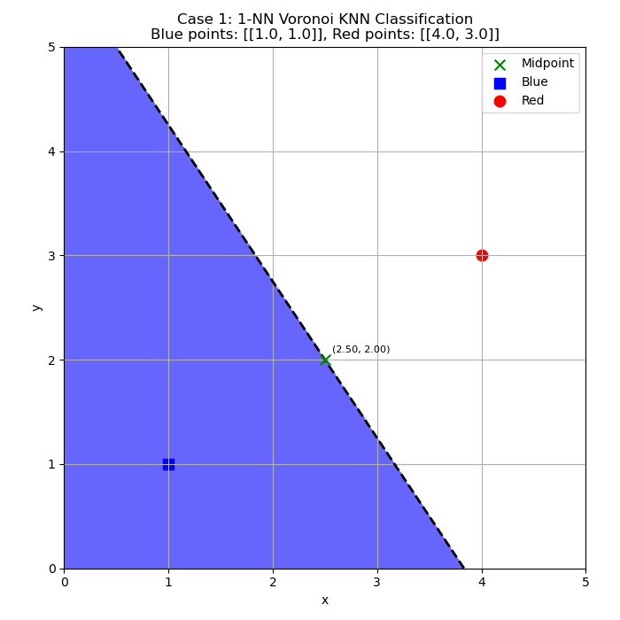
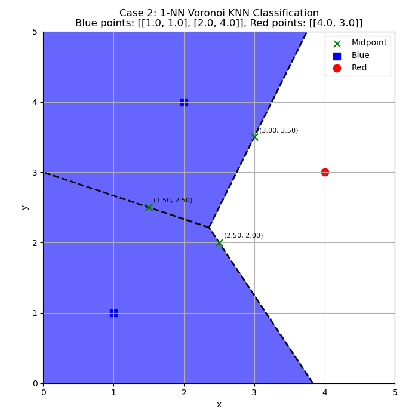
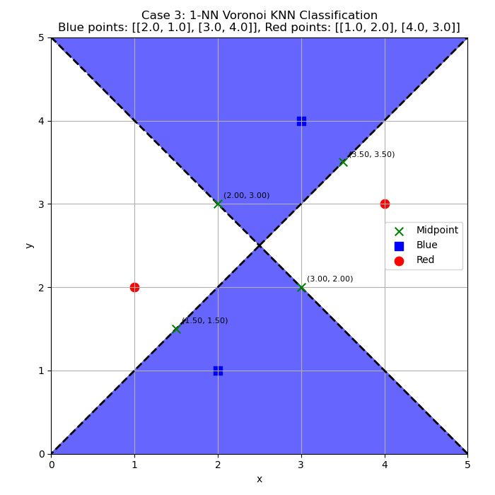

# Voronoi K-Nearest Neighbor Classification

## I. Overview

This project was completed for a Data Mining course and demonstrates **1-Nearest Neighbor (1-NN) classification** and its relationship to **Voronoi decision boundaries** using Python. The program classifies points in a two-dimensional plane, shades the region assigned to the blue class, and calculates the straight-line segments that form Voronoi boundaries.

## II. Training Data

The project uses three sets of two-dimensional training points:

| Case | Blue points (class 1) | Red points (class 0) |
| --- | --- | --- |
| 1 | `(1, 1)` | `(4, 3)` |
| 2 | `(1, 1)`, `(2, 4)` | `(4, 3)` |
| 3 | `(2, 1)`, `(3, 4)` | `(1, 2)`, `(4, 3)` |

The program combines the blue and red points into a single training dataset. Each point is represented by its `(x, y)` coordinates and its class label.

## III. KNN Classification

### 3.1 Nearest Neighbor Method

The program uses **K = 1** for all three cases. For each query point, it calculates the Euclidean distance to the training points and assigns the class of the nearest training point.

### 3.2 Query Grid

A two-dimensional grid is generated over the region `0 <= x <= 5` and `0 <= y <= 5`. The program uses **400 points along each axis**, producing a grid of **160,000 query points**. Each point in the grid is classified using the 1-NN method.

## IV. Voronoi Decision Boundaries

### 4.1 Perpendicular Bisectors

A Voronoi boundary consists of locations that are equally distant from neighboring training points. The program calculates the midpoint and perpendicular direction for each pair of training points and determines the equation of the corresponding perpendicular bisector.

### 4.2 Voronoi Edges

The program checks every pair of training points and clips each perpendicular bisector to the plotting area. It also checks the remaining training points to keep only the portion that belongs to the Voronoi diagram.

For each calculated edge, the program prints the two training points, their midpoint, and the equation of the perpendicular bisector.

## V. Visualization

For each of the three cases, the program generates a figure showing:

- **Blue squares** for blue training points and **red circles** for red training points.
- **Blue shading** for the region classified as the blue class; the red region is left unshaded.
- **Black dashed lines** for calculated Voronoi edges.
- **Green X markers** and coordinate labels for the midpoints used in the edge calculations.

The figures cover the same coordinate range (`0` to `5` on both axes) and are saved as:

- 
- 
- 

## VI. Observations

With **K = 1**, the decision at any query point is determined by its closest training point. The Voronoi boundaries divide the plane into regions of nearest-neighbor influence. Boundaries between differently labeled regions separate the two classes; edges between same-class points may also appear as part of the full Voronoi diagram.

The three cases demonstrate how adding and repositioning training points changes the decision regions and the geometry of the Voronoi diagram.

## VII. Running the Program

```bash
python Voronoi_Knn_Classification.py
```

The program prints the training points and boundary information, saves the three figures as PNG files, and displays the figures.
